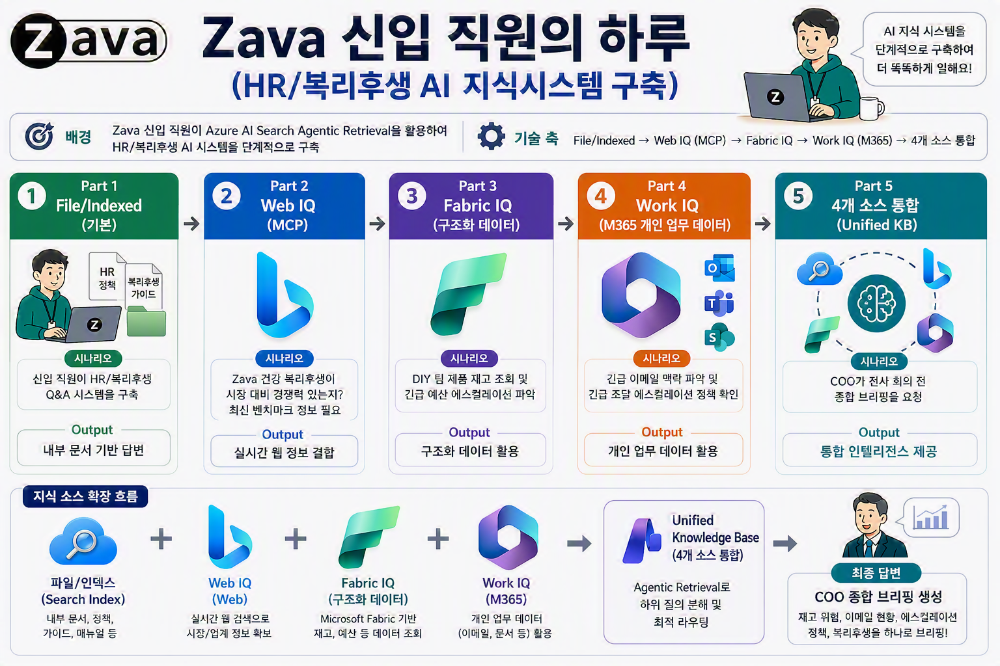
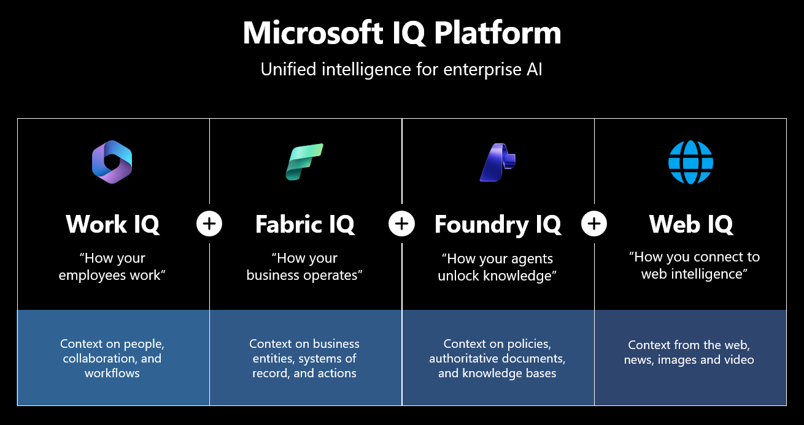
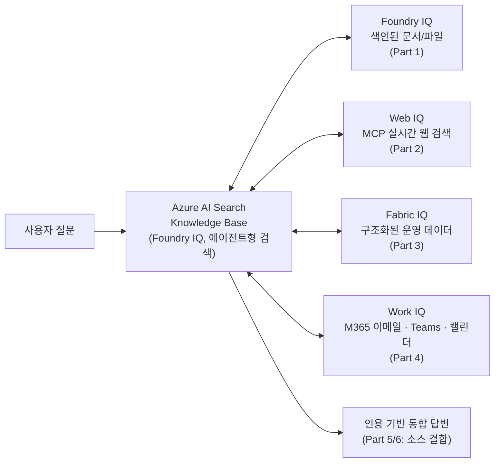

# Microsoft IQ Workshop

## 🔥 Agentic Knowledge Bases 구축 - Next-Level RAG with Azure AI Search

### 워크샵 소개

Zava(DIY 용품 소매업체) 신입 직원이 되어, Azure AI Search 에이전트형 검색의 **지식 베이스(Knowledge Base)** 에 소스를 하나씩 추가하며 HR·복리후생 질의응답 시스템을 확장하는 6단계 실습입니다.

- **Part 1**: File/Indexed Knowledge Source로 기본 지식 베이스 구축
- **Part 2**: Web IQ(MCP)로 실시간 웹 검색 추가
- **Part 3**: Fabric IQ로 구조화된 제품 데이터 추가
- **Part 4**: Work IQ로 M365 개인 업무 데이터 추가
- **Part 5**: 3가지 IQ(Foundry IQ + Fabric IQ + Web IQ)의 4개 지식 소스(HR 문서, 건강 문서, Fabric, 웹)를 통합
- **Part 6**: 4가지 IQ(Foundry IQ + Fabric IQ + Web IQ + Work IQ)의 5개 지식 소스를 통합

이 워크샵에서 다루는 4가지 지식 소스(IQ)는 다음과 같습니다.

- **Work IQ**: 로그인한 사용자의 Microsoft 365 데이터(이메일, Teams, 캘린더)를 위임 신원으로 질의하는 지식 소스
- **Fabric IQ**: Microsoft Fabric 온톨로지에 연결해 구조화된 운영 데이터(제품, 재고 등)를 질의하는 지식 소스
- **Foundry IQ**: 업로드된 파일이나 미리 구축된 검색 인덱스를 질의하는 기본 지식 소스(문서/정책 등 비정형 콘텐츠)
- **Web IQ**: MCP 서버를 통해 실시간 웹 검색 결과와 인용을 가져오는 지식 소스

이 워크샵은 **같은 Azure AI Search 서비스**에서 Part별 지식 베이스를 만들며 소스 구성을 확장하는 과정입니다. Part 2~4는 두 문서 소스에 각각 Web IQ, Fabric IQ, Work IQ를 추가하고, Part 5/6에서 이들을 통합합니다. Azure AI Search의 에이전트형 검색이 여러 소스를 오케스트레이션하고 인용 기반 답변을 합성합니다. 

### 본인 환경에서 시작하기 (Self-Paced Lab)

[환경 배포 가이드](labs/00-setup/README.md)의 단계를 따르세요. Codespaces 또는 로컬 VS Code에서 실습하며, 기존 devcontainer는 Python 3.12를 사용합니다. 로컬 수동 설치의 요구사항은 배포 가이드에 있습니다.

기존 리소스에서 Fabric IQ가 데이터 원본 바인딩 오류를 반환하면 [기존 Ontology 바인딩 검증 및 복구](labs/00-setup/README.md#ontology-bindings)를 실행하세요. 리소스를 재생성할 필요 없이 기존 Ontology ID를 유지한 채 복구할 수 있습니다.

### 학습 경로

아래 학습 경로에서 각 랩의 노트북을 바로 엽니다. 사전 요구사항, 실습, 검증과 정리 안내는 노트북에 모았습니다. 랩 README에는 메타데이터와 실행·탐색 링크만 둡니다. 공통 인증 모듈, 패키지 목록과 인덱스 복원 도구는 [notebooks](notebooks)에 유지합니다.

| 순서 | 랩 | 내용 |
|---|---|---|
| 00 | [환경 배포](labs/00-setup/README.md) | 계정·권한 준비, Codespaces 또는 로컬 환경 구성, Azure 배포 |
| 01 | [Foundry IQ](labs/01-foundry-iq/part1-standard-foundry-iq-kb.ipynb) | 파일 소스와 HR·건강 문서 인덱스로 기본 지식 베이스 구축 |
| 02 | [Web IQ](labs/02-web-iq/part2-search-mcp-kb.ipynb) | 내부 문서와 웹 검색 결합 |
| 03 | [Fabric IQ](labs/03-fabric-iq/part3-fabric-iq-to-kb.ipynb) | 구조화된 제품·재고 데이터와 사내 정책 조회 |
| 04 | [Work IQ](labs/04-work-iq/part4-work-iq-to-kb.ipynb) | Microsoft 365 업무 데이터와 사내 정책 조회 |
| 05 | [Work IQ 없는 통합 검색](labs/05-combined-iq/part5-except-workiq-kb.ipynb) | Foundry IQ·Fabric IQ·Web IQ의 4개 소스 결합 |
| 06 | [전체 IQ 통합 검색](labs/06-all-iq/part6-work-iq-fabric-iq-to-kb.ipynb) | Work IQ를 포함한 5개 소스를 단일 요청으로 조회 |

Work IQ의 결제·테넌트·앱 등록을 준비하지 못했다면 Part 4를 건너뛰고 Part 5까지 진행할 수 있습니다. Part 6은 Part 4의 설정과 메일 준비를 재사용합니다.

### 소요 시간

<!-- TODO: 저자가 준비 단계와 Part 1~6의 소요 시간을 확인하고 루트·랩 frontmatter와 본문에 함께 반영합니다. 배포 대기 시간만으로 전체 실습 시간을 산정하지 않습니다. -->

### 검증과 정리

각 랩에 연결된 노트북의 답변, 인용, 활동 로그로 성공 여부를 확인합니다. 답변이 표시돼도 필요한 지식 소스가 실패하거나 참조가 누락되면 해당 랩의 성공으로 판단하지 않습니다.

실습을 모두 마친 뒤 [환경 배포 가이드의 정리 절차](labs/00-setup/README.md#정리-clean-up)를 따르세요. 다음 랩에서 같은 리소스를 사용하므로 랩 사이에는 전체 배포를 삭제하지 않습니다. Copilot CLI 보너스를 진행했다면 [MCP 서버 설정 정리](notebooks/copilot-cli-sidequest.md#5-실습-후-정리)도 수행합니다.

### 🧠 학습 성과

이 워크샵을 마치면 다음을 할 수 있게 됩니다.

- Azure AI Search 에이전트형 검색을 사용해 색인된 엔터프라이즈 콘텐츠 위에 멀티 소스 지식 베이스를 구축합니다
- Web IQ, Fabric IQ, Work IQ 지식 소스로 지식 베이스를 확장합니다
- 여러 소스 유형(색인된 데이터, 구조화된 데이터, 업무 데이터, 웹 기반 데이터)을 하나의 지식 베이스에 결합합니다
- 인용 기반 답변 합성으로 지식 베이스에 질의합니다

### 💻 사용 기술

1. Foundry IQ (Azure AI Search)
1. Azure OpenAI (gpt-5.4, text-embedding-3-large)
1. Model Context Protocol (MCP)
1. Microsoft Fabric IQ 및 Work IQ
1. Python 및 Jupyter Notebooks

## 지원과 기여

질문과 오류 보고는 [지원 안내](SUPPORT.md), 문서·코드 변경은 [기여 안내](CONTRIBUTING.md)를 확인하세요. 보안 취약점은 공개 이슈가 아니라 기존 [보안 신고 안내](SECURITY.md)를 따릅니다.

## 원본 출처

이 워크샵은 [microsoft/Build26-LAB532-from-data-to-context-agent-ready-knowledge-with-foundry-iq](https://github.com/microsoft/Build26-LAB532-from-data-to-context-agent-ready-knowledge-with-foundry-iq) 리포지토리를 기반으로 재작성한 Self-paced Lab입니다. 원본 콘텐츠의 모든 권리는 원저작자에게 있습니다.

기존 [LICENSE](LICENSE), [LICENSE-DOCS](LICENSE-DOCS)와 자료별 저작권·라이선스 고지를 유지합니다.

## Copyright

이 프로젝트에는 프로젝트, 제품 또는 서비스에 대한 상표나 로고가 포함될 수 있습니다. Microsoft 상표 또는 로고의 승인된 사용은 [Microsoft 상표 및 브랜드 가이드라인](https://www.microsoft.com/legal/intellectualproperty/trademarks/usage/general)을 따라야 합니다. 이 프로젝트의 수정된 버전에서 Microsoft 상표나 로고를 사용할 때 혼동을 일으키거나 Microsoft의 후원을 암시해서는 안 됩니다. 제3자 상표나 로고의 사용은 해당 제3자의 정책을 따릅니다.
